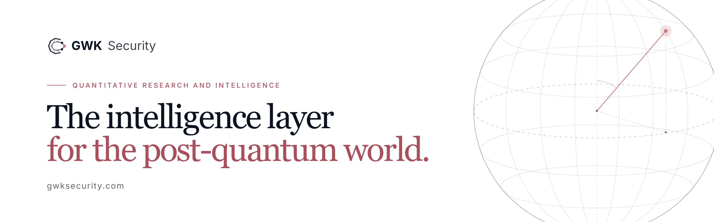

<a href="https://gwksecurity.com/en">
  <picture>
    <source media="(prefers-color-scheme: dark)" srcset="img/gwk-faixa-escuro.png">
    
  </picture>
</a>

  <a href="https://gwksecurity.com/en">gwksecurity.com</a> ·
  <a href="https://gwksecurity.com/en/metodologia">Methodology</a> ·
  <a href="https://gwksecurity.com/en/insights">Insights</a> ·
  <a href="mailto:contato@gwksecurity.com">contato@gwksecurity.com</a>

---

GWK Security measures how much of each organization's encrypted information remains exposed to
quantum computers, and for how long that matters. Its core instrument is the **IEQ, Quantum Exposure
Index**: a published formal model that turns public signals into a 0 to 100 score, explainable and
reproducible.

**No agent, no credentials, no access to internal systems.** Collection observes what the
organization already exposes online and organizes that evidence into three dimensions:
cryptographic vulnerability, observable exposure and confidentiality horizon.

## Products

One scientific and data foundation, applied to different decisions.

| | Product | What it delivers |
|---|---|---|
| 01 | **Exposure Report** | The executive readout of the organization's quantum cryptographic exposure, with evidence and priorities. No integration required. |
| 02 | **Sector Benchmark** | Where the organization stands against peers in the same sector. |
| 03 | **PQC Readiness Track** | Post-quantum migration as measured impact: score today, projected score and the gain from each milestone. |
| 04 | Regression Alerts | On the roadmap. |
| 05 | Third-Party Management | On the roadmap. |

## Research

The methodology can be read, tested and reviewed.

- **A Formal Basis for Quantum Cryptographic Exposure Measurement under HNDL Threat.**
  Rufino, Marcelino & Garcia (2026). [arXiv:2605.22569](https://arxiv.org/abs/2605.22569)
- **Detectability Limits for Intra-Block Temporal Drift in Finite-Key Entanglement-Based QKD.**
  Marcelino, Garcia & Rufino (2026). [arXiv:2605.24230](https://arxiv.org/abs/2605.24230)
- **Quantum Exposure Index Technical Report 2026-S1: Sector-Level HNDL Exposure.**
  Garcia, Marcelino & Rufino (2026). IEQ applied to 39,903 organizations across 17 sectors.
  [Zenodo, CC-BY](https://doi.org/10.5281/zenodo.20767648)

## Founders

| | |
|---|---|
| **Matheus Rufino**, Founder & CEO | PhD in Physics. Scientific and strategic direction; principal author of the IEQ formal framework. |
| **Rafael Duarte Marcelino**, Founder & CTO | Mechanical Engineering, MBA in Data Science. Data architecture, analytics and platform engineering for IEQ. |
| **Julio Smanioto Garcia**, Founder & CSO | MSc in Physics. Scientific front for QKD, post-quantum cryptography and experimental research. |

---

<b>Em português</b>

**A camada de inteligência do mundo pós-quântico.**

A GWK Security mede quanto da informação cifrada de cada organização continua exposta ao computador
quântico, e por quanto tempo isso importa. O instrumento central é o **IEQ, Índice de Exposição
Quântica**: um modelo formal publicado, que transforma sinais públicos em um score de 0 a 100,
explicável e reprodutível. Sem agente, sem credencial, sem acesso aos sistemas internos.

Produtos: Relatório de Exposição, Benchmark Setorial e PQC Readiness Track, com Alertas de Regressão
e Gestão de Terceiros em roadmap. Metodologia e dados públicos no
[arXiv](https://arxiv.org/abs/2605.22569) e no [Zenodo](https://doi.org/10.5281/zenodo.20767648).

[gwksecurity.com](https://gwksecurity.com) · contato@gwksecurity.com

