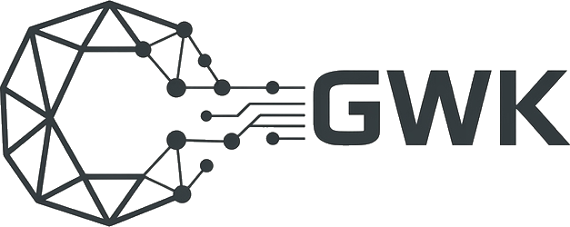

  <a href="https://gwksecurity.com">
    <picture>
      <source media="(prefers-color-scheme: dark)" srcset="img/gwk-logo-claro.png">
      
    </picture>
  </a>

<h3 align="center">A camada de inteligência do mundo pós-quântico.</h3>

  <a href="https://gwksecurity.com">gwksecurity.com</a> ·
  <a href="https://gwksecurity.com/metodologia">Metodologia</a> ·
  <a href="https://gwksecurity.com/insights">Insights</a> ·
  <a href="mailto:contato@gwksecurity.com">contato@gwksecurity.com</a>

---

A GWK Security mede quanto da informação cifrada de cada organização continua exposta ao computador
quântico, e por quanto tempo isso importa. O instrumento central é o **IEQ, Índice de Exposição
Quântica**: um modelo formal publicado, que transforma sinais públicos em um score de 0 a 100,
explicável e reprodutível.

**Sem agente, sem credencial, sem acesso aos sistemas internos.** A coleta observa o que a
organização já expõe na internet e organiza essas evidências em três dimensões: vulnerabilidade,
exposição e horizonte do dado.

## Produtos

Uma mesma base científica e de dados, aplicada a decisões diferentes.

| | Produto | O que entrega |
|---|---|---|
| 01 | **Relatório de Exposição** | Leitura executiva da exposição criptográfica quântica da organização, com evidências e prioridades. |
| 02 | **Benchmark Setorial** | Onde a organização se posiciona frente a pares do mesmo setor. |
| 03 | **PQC Readiness Track** | A migração pós-quântica em impacto medido: score hoje, score projetado e o ganho de cada marco. |
| 04 | Alertas de Regressão | Em roadmap. |
| 05 | Gestão de Terceiros | Em roadmap. |

## Pesquisa

A metodologia pode ser lida, testada e revisada.

- **A Formal Basis for Quantum Cryptographic Exposure Measurement under HNDL Threat.**
  Rufino, Marcelino & Garcia (2026). [arXiv:2605.22569](https://arxiv.org/abs/2605.22569)
- **Detectability Limits for Intra-Block Temporal Drift in Finite-Key Entanglement-Based QKD.**
  Marcelino, Garcia & Rufino (2026). [arXiv:2605.24230](https://arxiv.org/abs/2605.24230)
- **Quantum Exposure Index Technical Report 2026-S1: Sector-Level HNDL Exposure.**
  Garcia, Marcelino & Rufino (2026). IEQ aplicado a 39.903 organizações em 17 setores.
  [Zenodo, CC-BY](https://doi.org/10.5281/zenodo.20767648)

## Fundadores

| | |
|---|---|
| **Matheus Rufino**, Fundador & CEO | Doutor em Física. Direção científica e estratégica; autor principal do arcabouço formal do IEQ. |
| **Rafael Duarte Marcelino**, Fundador & CTO | Eng. Mecânica, MBA Data Science. Arquitetura de dados, analytics e engenharia da plataforma IEQ. |
| **Julio Smanioto Garcia**, Fundador & CSO | Mestre em Física. Frente científica de QKD, criptografia pós-quântica e pesquisa experimental. |

---

<b>In English</b>

**The intelligence layer for the post-quantum world.**

GWK Security measures how much of each organization's encrypted information remains exposed to
quantum computers, and for how long that matters. Its core instrument, the **IEQ (Quantum Exposure
Index)**, is a published formal model that turns public signals into an explainable, reproducible
0 to 100 score. No agent, no credentials, no access to internal systems.

Products: Exposure Report, Sector Benchmark and PQC Readiness Track, with Regression Alerts and
Third-Party Management on the roadmap. Methodology and data are public on
[arXiv](https://arxiv.org/abs/2605.22569) and [Zenodo](https://doi.org/10.5281/zenodo.20767648).

[gwksecurity.com/en](https://gwksecurity.com/en) · contato@gwksecurity.com

